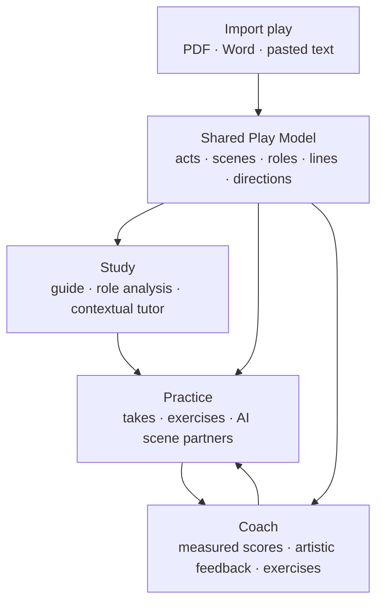
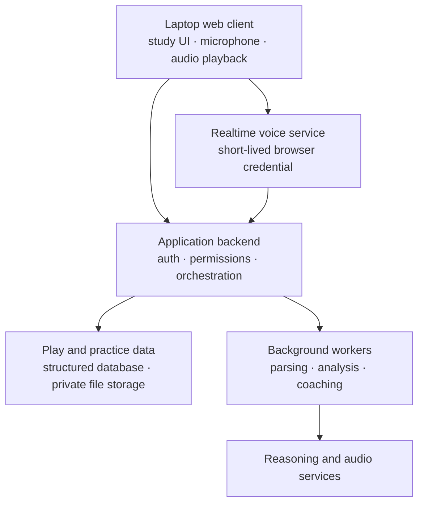

# Drama Practice App — Product and Technical Design

Date: 2026-08-01  
Status: Approved design for implementation planning

## 1. Product vision

Build a laptop-first web application that helps actors move through a complete preparation loop:

1. Understand an English-language stage play as a whole.
2. Understand and develop a selected role.
3. Practice vocally through complete takes and guided exercises.
4. Rehearse with AI performances of the other roles.
5. Receive evidence-based feedback and compare repeated takes.

The first release is an invite-only private beta for the owner and a small group of actors. It evaluates voice only. Camera-based assessment of facial expression and body movement is explicitly deferred.

The guiding product principle is that the uploaded script is converted once into a traceable Play Model. Study analysis, tutor answers, rehearsal cues, performance measurements, and coaching reports all reference the same acts, scenes, roles, lines, and stage directions.

## 2. Scope

### 2.1 Included in the private beta

- Invite-only actor accounts with isolated private data.
- English-language stage plays.
- Script input by PDF upload, Word upload, or pasted text.
- Parsing into acts, scenes, characters, dialogue, and stage directions.
- Actor review and correction of uncertain parsing.
- Structured whole-play study guide and contextual tutor.
- “My Role” workbook and scene-level analysis.
- Personal notes and an optional director’s concept.
- Complete recorded takes with post-take coaching.
- Live exercise mode that may pause and intervene.
- Scene rehearsal with distinct AI voices for other roles.
- Hybrid ratings: numeric scores for observable dimensions and qualitative coaching for artistic interpretation.
- Timestamped evidence, targeted exercises, and comparison across repeated takes.

### 2.2 Excluded from the private beta

- Mobile-native applications.
- Camera, facial-expression, gesture, blocking, or body-movement analysis.
- Public signup, subscriptions, or billing.
- Non-English scripts or multilingual rehearsal.
- Voice cloning or custom cast voices.
- Public script marketplace or script sharing.
- Casting, audition management, production scheduling, or full company administration.

## 3. User and access model

The beta user is an actor invited by an administrator. Each actor has a private play library containing original scripts, derived analysis, notes, recordings, practice history, and coaching reports. Authorization is enforced server-side on every resource rather than only through the interface.

There is no public onboarding or payment flow. The upload flow reminds users to provide only scripts they are entitled to use. Built-in AI voices are used in the beta; the system does not clone an actor’s voice.

## 4. Core product journey

An actor can move from whole-play study to a selected role and then directly into practice for any scene. After a take, the app returns evidence and a small number of prioritized notes. The actor applies those notes and repeats the scene.

## 5. Play ingestion and the Play Model

### 5.1 Ingestion flow

The actor uploads a PDF or Word file, or pastes text. The original content is stored privately and processed asynchronously. Text extraction is attempted first; scanned or image-only PDFs use OCR and receive a visible quality warning.

The parser proposes acts, scenes, characters, dialogue ownership, and stage directions. Before study analysis is generated, the actor sees a script-review screen containing uncertain names, scene boundaries, dialogue ownership, or unreadable passages. The actor may correct these issues. Corrections update the canonical Play Model and invalidate only derived artifacts affected by the correction.

### 5.2 Core entities

The Play Model contains at least:

- Play and edition metadata.
- Acts and ordered scenes.
- Characters, aliases, and normalized identities.
- Ordered script elements: dialogue, stage direction, heading, and transition.
- Stable line and passage identifiers independent of source page numbering.
- Character entrances, exits, and scene participation when derivable.
- User-selected role, personal notes, and director concept.
- Generated analysis artifacts with source references and version information.

Every generated claim that materially affects study or coaching should reference stable script elements. Source pages may be displayed for convenience but are not the primary identity because pagination varies by edition and input format.

## 6. Drama-study experience

After signing in, the actor sees a private play library. Opening a processed play displays a three-area workspace:

| Area | Purpose |
| --- | --- |
| Left navigation | Overview, characters, relationships, acts and scenes, My Role, original script |
| Main study area | Structured analysis for the selected topic |
| Contextual tutor | Questions grounded in the current play, role, scene, or selected passage |

### 6.1 Whole-play study

The study guide provides a concise synopsis, act-by-act account, central conflicts, themes, dramatic structure, turning points, character profiles, relationship map, and scene breakdowns. Each scene breakdown identifies participating characters, key events, objectives, conflict, and outcome.

The interface distinguishes facts explicitly supported by the script from plausible interpretations. The tutor answers from the uploaded play, links important answers to the text, labels inference, and states when the script does not support a definite conclusion.

### 6.2 Role workbook

After the actor selects My Role, the application creates a role workbook containing:

- Circumstances and history supported by the text.
- Relationships and how they change.
- Super-objective, scene objectives, obstacles, stakes, and possible tactics.
- Entrance and exit state for each scene.
- Beat changes and possible subtext.
- Important stage directions and what other characters say about the role.
- Alternative playable interpretations rather than one mandatory reading.
- Personal notes and a place to enter a director’s concept.

An actor may highlight a passage and ask questions such as “What changes here?”, “What does my character want?”, or “Give me three playable interpretations.” Any scene or passage can be opened directly in practice mode.

## 7. Practice and rehearsal

The actor selects a scene, confirms their role, and optionally selects an interpretation or director concept. The app provides three modes.

### 7.1 Complete take

The actor performs without interruption. The app records the take and relevant session timing, then produces detailed post-take feedback. This is the default coaching mode because it preserves performance flow.

### 7.2 Live exercise

The actor chooses an exercise or allows limited coaching interventions. The coach may pause at configured moments, ask for another tactic, repeat a line, suggest a playable action, or request an alternative interpretation. Live interventions are explicit and optional; the app does not unexpectedly interrupt a complete take.

### 7.3 Scene rehearsal

AI characters perform the other roles while a scene controller tracks position in the script. Each AI character receives a distinct built-in voice and a concise scene-specific performance direction. The controller routes the current line to the appropriate role and supports cue requests, restarts from a beat, repetitions, pauses, minor paraphrasing, missed lines, and recovery after losing scene position.

The beta does not promise a unique custom voice for every possible role. Multiple-character implementation may use a separate realtime session per active voice or scripted text-to-speech routing, while the rehearsal controller remains the authoritative source of scene position.

## 8. Coaching and evaluation

### 8.1 Processing pipeline

After a complete take, the application:

1. Transcribes the recording and aligns spoken passages with script elements.
2. Measures timing, pauses, pace, loudness, and vocal variation.
3. Reviews audible tone and delivery against the selected scene objective and interpretation.
4. Synthesizes a coaching report grounded in the script, the recording, and objective measurements.

### 8.2 Hybrid evaluation

Numeric ratings are limited to observable dimensions:

- Line accuracy.
- Clarity.
- Pacing and rhythm.
- Cue responsiveness.
- Vocal variation.

Objectives, tactics, subtext, emotional progression, listening, and interpretation receive qualitative coaching. The app does not claim that one interpretation is objectively correct. Feedback uses language such as “this choice communicated…” and identifies alternate playable choices.

Every report contains:

- Timestamped evidence that the actor can replay.
- No more than three prioritized improvements.
- A targeted exercise or concrete next attempt.
- Strengths worth preserving.
- Comparison with previous takes of the same scene when available.
- Actions to try again, choose an alternative interpretation, or continue rehearsal.

Scores track an actor’s improvement across comparable takes. They are not intended to rank different actors or replace a director or acting teacher.

If transcription is uncertain, the report marks the affected passage and does not treat the uncertainty as definite line inaccuracy.

## 9. Model and service architecture

The recommended approach is a hybrid drama studio rather than a single-model system.

| Responsibility | Initial model or mechanism |
| --- | --- |
| Play, role, and scene analysis | GPT-5.6 family reasoning model |
| Contextual tutor and final coaching synthesis | GPT-5.6 family reasoning model |
| Live speech-to-speech rehearsal and exercises | `gpt-realtime-2.1` |
| Recorded audio interpretation | `gpt-audio-1.5` |
| Transcript generation | `gpt-transcribe` |
| Scripted character speech when direct realtime routing is unsuitable | `gpt-4o-mini-tts` or current supported successor |
| Timing, loudness, pitch, and related observable features | Deterministic audio analysis |

Model identifiers are configuration, not domain logic. They are current assumptions as of the design date and must be replaceable after representative evaluations. The permanent provider credential remains on the server. For browser-based realtime rehearsal, the backend issues a short-lived credential so the browser can connect directly with minimal voice latency.

## 10. Application architecture and data flow

The components have clear responsibilities:

- Web client: library, study workspace, tutor, recorder, rehearsal controls, and reports.
- Application backend: accounts, authorization, play management, short-lived session credentials, and workflow orchestration.
- Play-processing worker: extraction, OCR routing, structural parsing, line identity, and study generation.
- Rehearsal controller: scene position, voice assignment, cues, restarts, and session events.
- Coaching worker: transcript alignment, audio measurements, audio-model analysis, and report generation.
- Structured database: users, plays, Play Model entities, notes, sessions, and reports.
- Private object storage: original scripts, recordings, and derived media.

Script ingestion follows: upload → extraction → structural parsing → actor review → Play Model → study analysis.

Practice follows: choose scene and interpretation → realtime rehearsal or recorded take → transcript and measurements → audio interpretation → coaching report.

Completed takes are processed asynchronously so deep analysis does not block the recording interface.

## 11. Reliability and error handling

The product exposes uncertainty instead of silently producing confident but unreliable output.

- Scanned PDFs trigger OCR and a visible quality warning.
- Uncertain parsing appears in script review rather than being hidden.
- Password-protected, corrupted, or unsupported files fail with a specific recovery instruction.
- Actor corrections regenerate only dependent analysis.
- A microphone check detects low signal, excessive background noise, and clipping before recording.
- Low-confidence transcript regions are marked and excluded from automatic penalties.
- The rehearsal controller distinguishes intentional paraphrasing, repetition, omission, and loss of scene position where possible.
- If realtime rehearsal loses its connection, the current take is preserved locally when possible and the app may continue in scripted playback mode.
- Background jobs are idempotent and restartable, preventing duplicate plays or reports after retries.

User-visible processing states are: needs actor review, temporary failure—retrying, action required, and completed with limitations.

## 12. Privacy and security

- Scripts, recordings, notes, reports, and session credentials are private and actor-isolated.
- Authorization is checked on every server request and file operation.
- Original files and recordings are stored privately and are not exposed through public URLs.
- Permanent provider credentials never reach the browser.
- Users can delete an individual recording or a play with its derived analysis.
- Audio is retained for progress comparison by default, with a visible delete control and an option not to retain a take after analysis.
- Built-in AI voices are used in the beta; voice cloning is excluded.
- The system records sufficient operational events to investigate processing failures and unauthorized-access attempts without exposing script or audio content unnecessarily.

## 13. Testing strategy and beta success criteria

### 13.1 Test strategy

Play Model tests use representative English stage plays in PDF, Word, and pasted-text form. Public-domain or purpose-written fixtures verify act and scene boundaries, dialogue ownership, stage directions, stable line references, and consistency across input formats.

Study tests verify source grounding, correct character and scene references, explicit separation of fact and interpretation, contextual tutor behavior, and propagation of actor corrections.

Voice and rehearsal tests include clean speech, background noise, paraphrasing, missed lines, long pauses, interruptions, restarts, and connection loss. They measure transcription accuracy, scene-position recovery, cue timing, first-audio latency, and preservation of recorded work.

Coaching reports are compared with reviews from actors or acting teachers. Exact agreement on artistic judgment is not required. Reports must consistently identify observable features, cite defensible evidence, and recommend useful exercises. Repeated-take tests verify that measurable improvements are reflected in the report.

Authorization tests ensure that one beta user cannot access another user’s scripts, recordings, notes, credentials, or reports.

### 13.2 Beta acceptance criteria

- For representative digitally generated plays up to 150 pages, at least 95% of dialogue is assigned to the correct character and structural review requires no more than ten corrections.
- Every major study claim exposes at least one supporting script reference or is explicitly labeled as interpretation.
- At least 90% of beta usability-test participants can move from whole-play study to role study to scene practice without assistance or reconfiguration.
- Under measured beta network conditions, median time from the actor finishing a line to first partner audio is at most 1.5 seconds and the 95th percentile is at most 2.5 seconds.
- At least 90% of five-minute takes receive an evidence-linked report within 90 seconds after upload completes.
- Reports present no more than three priority improvements per take.
- At least 80% of surveyed coaching sessions receive a score of 4 or 5 out of 5 for both specificity and actionability.
- Uncertain transcription is never presented as definite acting failure.
- No beta user can access another user’s private content.

## 14. Future roadmap: collaborative cast rehearsal

A future version may add shared productions. A director or production owner uploads the play, invites the cast, and assigns or approves role claims, including principal actors, understudies, and shared roles.

An actor may optionally enroll a synthetic voice through a deliberate consent workflow:

1. Provide explicit consent for creation and rehearsal use.
2. Record the provider-required consent statement.
3. Provide clean reference samples.
4. Review and approve a generated sample.
5. Select which production members may use the voice.

When a cast member rehearses alone, the scene controller can use enrolled voices for absent actors. The recommended design combines:

- A recorded cue bank containing the actor’s authentic delivery of important lines or scenes.
- A consented synthetic voice that fills missing lines, alternate pacing, or revised material.

Recorded performances take precedence when available because a vocal likeness does not reproduce an actor’s exact artistic choices.

Safeguards include production-scoped access, explicit synthetic-speech labels, role-claim approval, immediate access removal after cast changes, actor-controlled revocation and deletion, and an audit record of synthetic-voice generation. Availability depends on the voice provider’s eligibility, consent, and custom-voice requirements at implementation time.

The broad roadmap is: private laptop beta → mobile and video coaching → shared productions → cast voice enrollment → collaborative rehearsal analytics.

## 15. Design decisions summary

- Product shape: hybrid drama studio.
- Priority order: full drama study, acting coach, personal scene rehearsal.
- Initial platform: laptop web browser.
- Audience: invite-only private beta.
- Content: English stage plays.
- Inputs: PDF, Word, and pasted text.
- Study interface: structured guide plus contextual chat.
- Coaching modes: post-take and optional live intervention.
- Evaluation: hybrid measurable scores plus qualitative artistic coaching.
- Interpretation: alternatives by default, with optional system recommendation or director concept.
- Initial modality: voice only.
- Future direction: mobile, video, shared casts, and consented cast voices.
